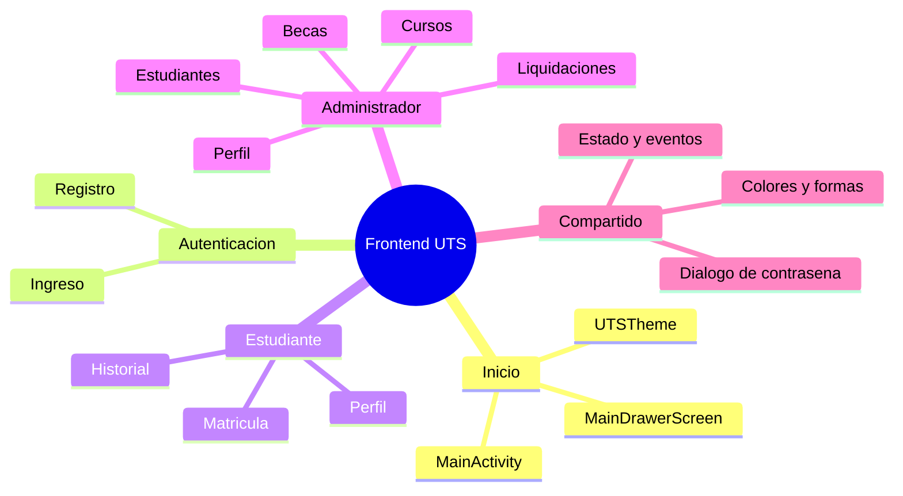

# Mapa general

[[00 - Inicio]]

**Para exponer:** “La aplicación usa una sola Activity. Dentro de ella, Compose muestra autenticación o las pantallas del menú, según el estado del perfil y el rol”.

Continúa en [[03 - Inicio y estructura de archivos]].
