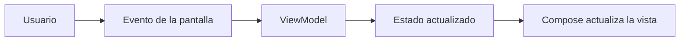

# Estado y eventos

[[00 - Inicio]]

- **`ServiciosUiState`:** datos que determinan lo visible.
- **`ServiciosViewModel`:** expone el estado y recibe acciones.
- **Pantallas:** observan con `collectAsStateWithLifecycle()`.

| Dato | Para qué se usa |
|---|---|
| `perfilGuardado`, `esAdmin` | Contenido y rol mostrado. |
| `campoCodigo`, `campoPassword` | Formulario de ingreso. |
| `cursosSeleccionados` | Casillas, contador y cálculo. |
| `listaLiquidaciones`, `totalAcumulado` | Historial y resumen. |
| `mensajeMensajeEstado`, `esError` | Avisos. |
| `mostrarDialogoCambioPassword` | Visibilidad del modal. |

**Ejemplo:** escribir código llama `onCodigoCambiado`; el nuevo `campoCodigo` vuelve al campo de texto.

La navegación y los formularios administrativos también tienen estado local con `remember` o `rememberSaveable`.

**Para exponer:** “Los datos bajan a la pantalla y los eventos suben al ViewModel”.
